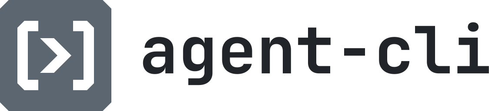

# agent-cli-plugins

A Claude Code marketplace for five small CLIs that let AI agents work with Apple Mail, Notes, Calendar, Reminders and Paperless-ngx.

[](https://github.com/Bam679/agent-cli-plugins/actions/workflows/ci.yml)
[](https://scorecard.dev/viewer/?uri=github.com/Bam679/agent-cli-plugins)
[](LICENSE)

<picture>
  <source media="(prefers-color-scheme: dark)" srcset="assets/logo-dark.svg">
  
</picture>

## About

This repository is the entry point to the agent-cli family. It holds the marketplace that lists all five plugins, a shared skill that teaches agents the common rules once, and the shared Go code and repository template that keep the five CLIs consistent.

| CLI | What an agent can do with it | Repository |
|---|---|---|
| `apple-mail` | List, search and read mail; save drafts; mark, flag, move and trash. It cannot send. | [apple-mail-cli](https://github.com/Bam679/apple-mail-cli) |
| `apple-notes` | Search and read notes; create, append and move them | [apple-notes-cli](https://github.com/Bam679/apple-notes-cli) |
| `apple-calendar` | Read and search events; create, update and delete them | [apple-calendar-cli](https://github.com/Bam679/apple-calendar-cli) |
| `apple-reminders` | Read lists and due tasks; add, complete and update reminders | [apple-reminders-cli](https://github.com/Bam679/apple-reminders-cli) |
| `paperless` | Search, read and download documents; upload and tag them | [paperless-cli](https://github.com/Bam679/paperless-cli) |

## Why a CLI instead of an MCP server

There are MCP servers for some Apple apps, but each tool call goes back through the model, and the tool definitions fill the context before the agent has done anything. With a CLI, the agent learns the commands from a short skill, filters the output with `jq` or `grep`, and chains several steps in one script, for example turning this week's events into reminders in a single run. That is faster and uses far fewer tokens. Single-purpose CLIs exist for some of these apps, but not as a set with one output format and one permission model, which is what you need to let Claude manage everyday things on a Mac.

## Features

- One output format for all five tools: text lines, JSON or NDJSON, with field selection, paging and size limits
- Read-only by default; writes need a policy file and `--confirm`, and every write can be previewed with `--dry-run`
- The same exit codes everywhere, so an agent knows whether to fix a flag, stop, or ask the user
- A shared skill that loads the reference for one tool only when the agent needs it, and a session-start hook that tells the agent which CLIs are installed
- Signed releases with SBOMs and build provenance, and no third-party Go dependencies

## Installation

Install the CLIs you want, for example with Homebrew:

```sh
brew install Bam679/tap/apple-mail Bam679/tap/apple-reminders
```

Each CLI's README also describes the signed release archives and `go install`.

Then add the marketplace and the plugins:

```sh
claude plugin marketplace add Bam679/agent-cli-plugins
claude plugin install agent-cli@agent-cli-plugins         # shared skill and detection
claude plugin install apple-mail@agent-cli-plugins        # one plugin per CLI you use
claude plugin install apple-reminders@agent-cli-plugins
```

Every CLI repository is also a marketplace of its own (`claude plugin marketplace add Bam679/apple-mail-cli`). Install each plugin from one source only: when the same plugin comes from two marketplaces, Claude Code runs the hooks of just one copy.

## Usage

Once the plugins are installed, ask Claude in plain language, for example "Which reminders are due this week?" or "File the latest invoice from my mailbox in Paperless". The skills tell the agent which commands to run. You can run the same commands yourself:

```sh
apple-reminders list --due-before +7d
apple-calendar events --from today --to +7d --json --fields start,title
apple-mail search invoice --since -30d --limit 5
```

At the start of every session the `agent-cli` plugin prints a line such as `agent-cli tools installed: apple-mail@0.1.0 apple-reminders@0.1.0; not installed: apple-notes …`, so the agent knows what it can use.

## Permissions

Every CLI only reads until you allow writes in `~/.config/agent-cli/<tool>.json`. The binary enforces that file, so the rules hold under every agent, and no flag or environment variable can widen them. A write is checked against the policy, previewed with `--dry-run` and applied with `--confirm`.

```json
{
  "version": 1,
  "operations": { "allow": ["read", "add", "complete"], "deny": ["delete"] },
  "scopes": { "write": { "allow": ["Agent*"] }, "read": { "deny": ["Health*"] } },
  "limits": { "max_write_batch": 10 }
}
```

For Claude Code, `<tool> policy --claude-settings` prints recommended settings: read commands allowed, write commands ask first, the policy directory protected, and the Bash sandbox enabled with only the CLI excluded. In the sandbox an agent cannot reach Apple Events, the network or the policy file directly, so the CLI and its policy are the only way to your data.

[ADR-0003](docs/adr/0003-permission-model.md) records the decision, and [Is a binary-enforced policy overkill?](docs/explanation/permission-research.md) compares it with a dozen similar tools.

## Threat model

| Threat | Mitigation |
|---|---|
| Prompt injection through mail, notes or documents | Writes are off by default and checked in the binary. Skills tell agents to treat returned content as data. `apple-mail` has no way to send mail. |
| The agent changes its own permissions | Fixed policy path, ownership and mode checks, plugin hooks, deny rules, and the Claude Code sandbox |
| Input turns into code | Static JXA scripts that receive JSON, covered by fuzz tests; typed HTTP parameters for Paperless |
| Supply chain | No third-party Go dependencies, SHA-pinned Actions, CodeQL, gosec, govulncheck, gitleaks and Scorecard; signed releases with SBOMs and build provenance |

## Protecting PII with AI agents

Whatever an agent reads is sent to the model provider. You can reduce that:

- Hide sensitive containers with `scopes.read.deny`, for example private folders, health lists or `tag:medical`.
- Ask for less. `--fields`, `--limit` and `--max-chars` keep personal data out of the context, and the skills tell agents to use them.
- Mask personal data before it reaches the model. [PasqualePillitteri/claude-privacy-tool](https://github.com/PasqualePillitteri/claude-privacy-tool) adds an offline masking hook to Claude Code, and [gregmos/PII-Shield](https://github.com/gregmos/PII-Shield) anonymises PII through an MCP server, a skill or a CLI.
- Scan tool output with a Claude Code `PostToolUse` hook: [gitleaks/gitleaks](https://github.com/gitleaks/gitleaks) and [trufflesecurity/trufflehog](https://github.com/trufflesecurity/trufflehog) find secrets, and [data-privacy-stack/presidio](https://github.com/data-privacy-stack/presidio) (formerly microsoft/presidio) finds names, addresses, IBANs and phone numbers.
- Keep real data out of bug reports. Redact output or use synthetic examples.

## Documentation

- [Architecture decisions](docs/adr): stack, plugin distribution, permission model, macOS bridge
- [Is a binary-enforced policy overkill?](docs/explanation/permission-research.md)
- Each CLI repository has a tutorial, a how-to guide for permissions, a CLI reference and a page on its security model under `docs/`.

## Contributing

Changes to shared behaviour start here. `scaffold/go` holds the shared Go packages (argument parsing, output, exit codes, policy, write gate, the JXA runner) with tests, fuzz targets and golden files. `scaffold/repo` holds the CI, release, documentation and plugin templates.

```sh
make check                                # tests, lint, govulncheck, gitleaks, plugin validation
python3 scaffold/render.py ../apple-mail-cli   # render the scaffold into a CLI repository
make drift                                # check that sibling repositories are up to date
make install-smoke                        # install every plugin into a throwaway Claude config
```

See [CONTRIBUTING.md](CONTRIBUTING.md) and [SECURITY.md](SECURITY.md).

## Licence

MIT. See [LICENSE](LICENSE).
