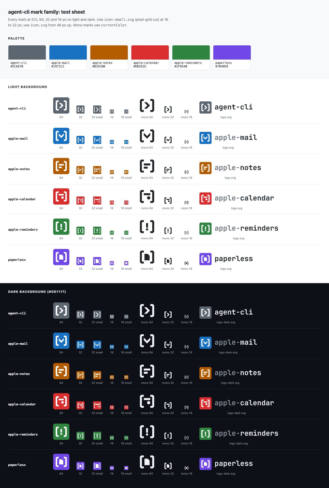

# agent-cli brand marks

## Concept

Every mark is a **bracketed scope**: a pair of square brackets with one glyph inside. In command-line usage
syntax, brackets mark a bounded, optional part (`cmd [flags]`). That fits these tools: the agent works inside
explicit limits, it can only read by default, and it writes only when a user-owned policy allows it.

The master mark `agent-cli` holds the prompt chevron. Each tool keeps the brackets and changes the glyph:

| Repo | Glyph | Idea |
|---|---|---|
| `agent-cli` | `›` prompt chevron | the agent at the command line |
| `apple-mail` | chevron turned down | mail only comes in, and nothing is sent. Inside the brackets it also suggests an envelope flap. |
| `apple-notes` | a line and a half | written text |
| `apple-calendar` | header bar + one dot | a page header with one marked day |
| `apple-reminders` | `!` | a nudge |
| `paperless` | page with a 45° corner | an archived document |

Geometry: 512 grid. Straight strokes are 48 units. All diagonals are exactly 45°, and every diagonal stroke
(chevrons and bracket chamfers) is about 45 units thick measured perpendicular, so it looks as heavy as the
straight strokes. The tile is a square with 40-unit 45° chamfers, which echo the bracket corners. It is
deliberately not a rounded app-icon squircle.

## Files (per repo folder)

| File | Use |
|---|---|
| `icon.svg` | Main mark on its colour tile, 512×512. Use at 48 px and up. |
| `icon-small.svg` | Pixel-grid cut for 16 to 32 px (favicons, tabs, list icons). It has 1-px brackets, 2-px glyphs and square dots. |
| `icon-mono.svg` | Brackets and glyph only, no tile, in `currentColor`. Use it in one-colour print, inline UI and badges. |
| `logo.svg` | Horizontal lockup for light backgrounds |
| `logo-dark.svg` | Horizontal lockup for dark backgrounds |
| `icon-512.png` | 512×512 raster of `icon.svg` (Claude Code plugin icon) |

The wordmarks are set in JetBrains Mono NL Bold (SIL OFL 1.1) and converted to outlines, so the SVGs need no font.

## Palette

| Role | Hex | Contrast on #FFFFFF | Contrast on #0D1117 |
|---|---|---|---|
| agent-cli (master, slate) | `#5C6670` | 5.85 | 3.23 |
| apple-mail | `#1971C2` | 5.02 | 3.77 |
| apple-notes | `#B35C00` | 4.72 | 4.01 |
| apple-calendar | `#DB2E2E` | 4.73 | 4.00 |
| apple-reminders | `#2F8540` | 4.62 | 4.10 |
| paperless | `#7048E8` | 5.55 | 3.41 |
| Ink (name, light) | `#212529` | 15.4 | n/a |
| Ink muted (`apple-` prefix, light) | `#6C757D` | 4.69 | n/a |
| Ink (name, dark) | `#F1F3F5` | n/a | 17.0 |
| Ink muted (prefix, dark) | `#868E96` | n/a | 5.70 |

Every accent passes WCAG AA for text on white (4.5:1). The same ratio applies to the white glyph on its tile.
Every tile also stands out from dark backgrounds by at least 3:1. The `apple-` prefix is set in the muted ink so
that the product noun leads and the Apple name stays only a description of the target app.

## Clear space and minimum size

- **Clear space:** keep a margin of at least ¼ of the tile height on every side. The lockup uses the same
  distance (64 units at 256) between the tile and the name.
- **Minimum size:** `icon-small.svg` works down to 16 px. Use `icon.svg` from 48 px up. Keep the lockup at
  least 24 px tall; below that, use the icon alone.

## Do

- Use each repo's own colour and glyph. Use the slate `agent-cli` mark only for the umbrella repo and marketplace.
- Use `icon-mono.svg` with `currentColor` when only one colour is available.
- Use `logo-dark.svg` on dark surfaces.

## Don't

- Don't redraw the tile as a rounded squircle, and don't add gradients, shadows, glass or bevels.
- Don't add Apple-like imagery (apple, leaf or bite shapes), Apple system colours or SF Symbols-style glyphs.
- Don't recolour one tool's mark with another tool's accent, and don't mix two glyphs in one bracket pair.
- Don't put text, version numbers or badges inside the brackets.
- Don't stretch, rotate or outline the marks, and don't put a coloured tile on a background of a similar hue.
- Don't use `icon.svg` below 32 px. Use `icon-small.svg` there.

These tools are not affiliated with Apple Inc. or the Paperless-ngx project. The product names only describe
the app each tool works with.
